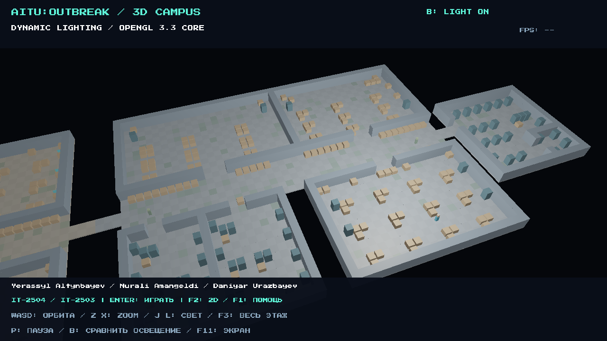

# AITU OUTBREAK

A native C++17 and OpenGL 3.3 university rescue game with a perspective campus inspection mode. The third-floor map is shared by both views. Three playable blocks, stealth patrols, throwable distractions, temporary stun, phone objectives, four-wire backup-power repair and a ventilation rescue ending are included.

Team: **Yerassyl Altynbayev, Nurali Amangeldi, Daniyar Urazbayev**. Groups: **IT-2504 / IT-2503**.

## Запуск

Откройте `AITU_OUTBREAK.exe` в корне проекта. Папка `assets` должна находиться рядом. При запуске сразу показан 3D-кампус с динамическим освещением; **Enter** начинает игру, **F2** переключает 3D и 2D. Сеть для запуска не нужна. **F11** переключает полный экран; `--windowed` запускает в окне.

## Build on Windows

Requirements: Windows 10/11 x64, an OpenGL 3.3-capable driver, Visual Studio 2022 Build Tools with Desktop development with C++ and a Windows SDK, CMake 3.20 or newer, Git. All C++ dependencies are bundled; Python and package installation are not required to build or play.

```powershell
git clone https://github.com/shaqx77/AITU-OUTBREAK.git
cd AITU-OUTBREAK
cmake -S . -B build -A x64
cmake --build build --config Release --parallel 4
.\build\Release\AITU_OUTBREAK.exe --windowed
ctest --test-dir build -C Release --output-on-failure
```

The build copies `assets` beside the executable. Errors are written to the console and `error.log`. A compiler is needed only for rebuilding. The program uses GLFW, GLAD, GLM, stb_image, miniaudio and nlohmann/json; see [THIRD_PARTY.md](THIRD_PARTY.md).

## Controls

| Context | Keys | Action |
| --- | --- | --- |
| Global | F1 or H | Show help; H is Home inside the phone |
| Global | F2 | Switch perspective inspection and the game |
| Global | B | Toggle dynamic lighting; state is shown on screen |
| Global | P | Pause animation and game simulation |
| Global | F11 or Alt+Enter | Toggle borderless fullscreen in the game; F11 in inspection |
| 3D | W / S, A / D | Orbit elevation and azimuth |
| 3D | Z / X | Zoom in and out |
| 3D | J / L | Change the light orbit angle |
| 3D | F3 | Whole-floor / block-3 view |
| 3D | Enter / Escape | Start the game / return to its menu |
| Game | WASD / arrows | Walk |
| Game | Shift | Quiet walk |
| Game | E | Interact |
| Game | Q / right mouse | Throw a bottle toward the cursor |
| Game | G / Space | Auto-aimed temporary stun after collecting the mop |
| Game | F | Flashlight |
| Game | Tab | Phone; home apps, messages, tasks and map |
| Phone | 1 / 2 / 3 on Home | Messages / tasks / map |
| Phone | A / D, M, H | Switch apps / map overview / Home |
| Wire panel | Drag mouse, or 1–4 twice | Left row then matching right row |
| Game | Escape, then R | Pause, then retry the checkpoint |
| Dialogues | E / Enter / Space | Finish typing, then continue |

## Graphics and verification

The 3D view uses a perspective matrix, an orbit view matrix, a depth buffer, CCW back-face culling and per-fragment diffuse/specular lighting. The 2D game uses an off-screen color pass and a lighting/visibility composition pass. UI alpha layers deliberately do not use depth testing or culling. Shader files are in `assets/shaders`; implementation and equations are explained in [docs/REPORT.pdf](docs/REPORT.pdf).

```powershell
.\build\Release\AITU_OUTBREAK.exe --self-test
.\build\Release\AITU_OUTBREAK.exe --benchmark
.\build\Release\AITU_OUTBREAK.exe --capture graphics
```

The benchmark writes `benchmark.csv` in the working directory. It measures completed frame time with `glFinish`, includes CPU and GPU work, and is not a GPU-only query. On the tested Intel UHD Graphics driver, the 1280×720 inspection scene measured about 318 FPS with lighting and 329 FPS without it. These are local measurements, not a guarantee for every lab computer.

## Submission documents

- [Report with pipeline diagram, equations, screenshots, references and FPS](docs/REPORT.pdf)
- [Requirements audit with honest status marks](docs/REQUIREMENTS.md)
- [Five-minute defence outline and shader exercises](docs/DEFENCE_GUIDE.md)
- [60-second backup video rendered by this build](docs/demo.mp4)
- [Measured performance data](docs/benchmark.csv)

**Before final submission:** confirm the assigned topic number and exact title with the instructor. The supplied requirements refer to a Section 6 topic checklist but do not contain that section. Upload the backup video to YouTube or Google Drive, check public access and add its link to the report. Confirm individual module ownership and group membership; proposed assignments are marked in the report. The current report cannot certify an unavailable topic-specific checklist or individual shader knowledge.

The implementation received substantial generative assistance. Its scope and the required team review are disclosed in the report. Retained third-party license notices identify the actual library and asset authors.


